
 

I build computer vision systems and take them all the way to production. I've detected products on retail shelves, found pneumonia in chest X-rays and spotted waste in rivers. My rule is that a model isn't done until it holds up on data it has never seen, and until someone can actually use it.

**Right now:** open to **AI/ML engineer** roles, fresh off an ML traineeship at FringeCore (City Group).

 


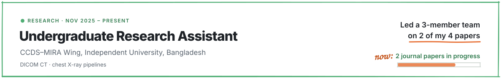

 

  <a href="https://kazrkb.github.io/portfolio/project.html?id=nodule">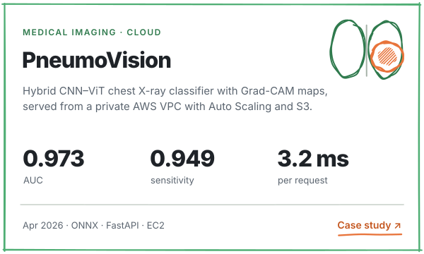</a>
  <a href="https://kazrkb.github.io/portfolio/project.html?id=river-waste">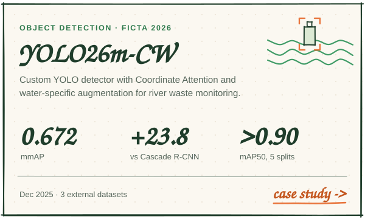</a>
  <a href="https://kazrkb.github.io/portfolio/"></a>
  <a href="https://huggingface.co/spaces/kazrkb/diabetes-prediction"></a>

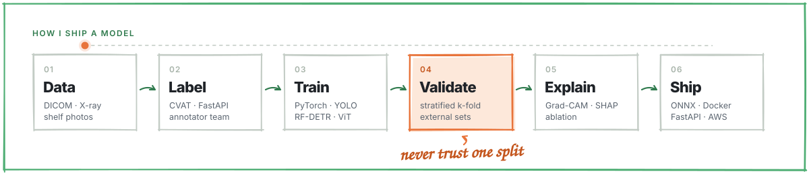

<b>More projects</b>

 

- **Lung nodule detection** — PyTorch detection pipeline on 3D chest CT scans (DICOM) from LIDC-IDRI
- **Device-independent HAR** — activity recognition from accelerometer and gyroscope streams that generalises across wearables
- **[Customer churn pipeline](https://kazrkb.github.io/portfolio/project.html?id=bd-churn)** — Python ETL of 6,418 records into MySQL, four churn models, Power BI reporting

 


 


  


  &nbsp;
  <a href="https://linkedin.com/in/kazimdrakibulhassan">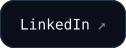</a>&nbsp;
  &nbsp;
  

<!-- Kazi Md. Rakibul Hassan, kazrkb, AI Engineer, Machine Learning Engineer, Computer Vision, Medical Imaging, Deep Learning, PyTorch, YOLO, RF-DETR, Vision Transformer, BiomedCLIP, LLM, RAG, MLOps, FastAPI, Docker, AWS, Bangladesh -->
